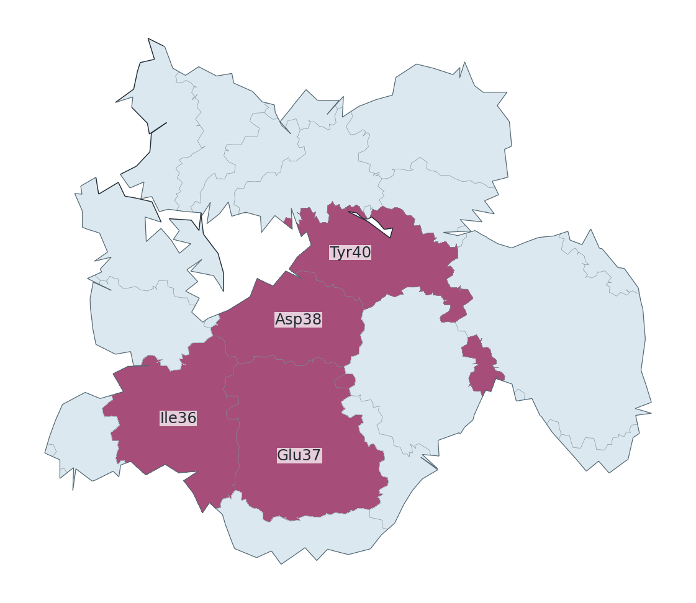
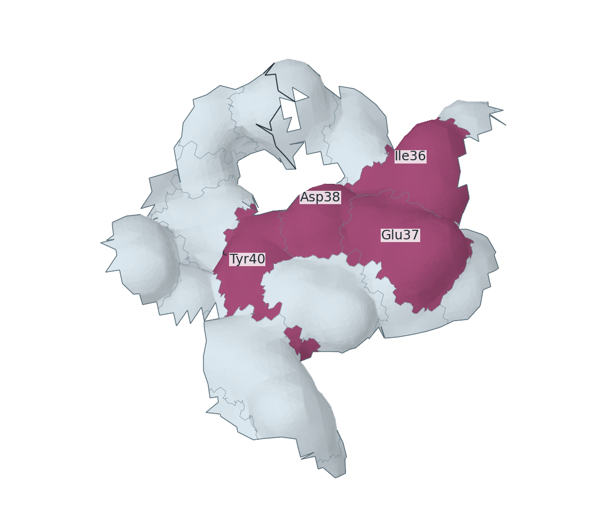
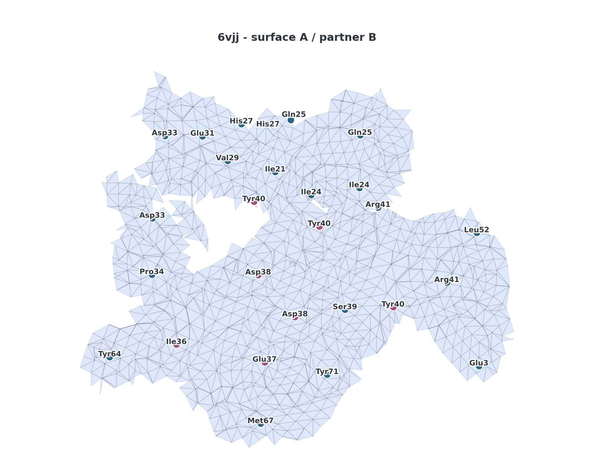
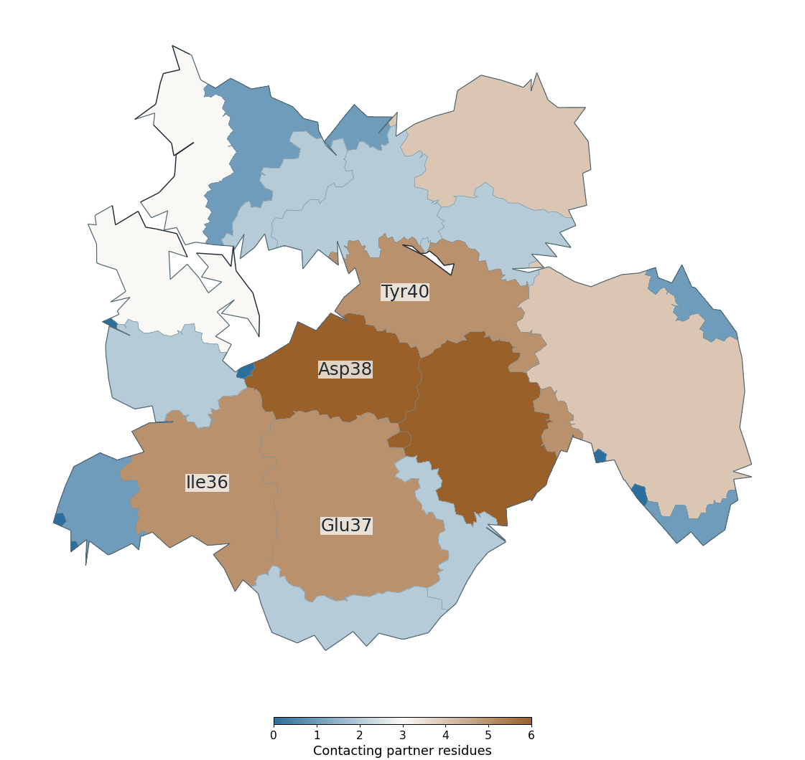
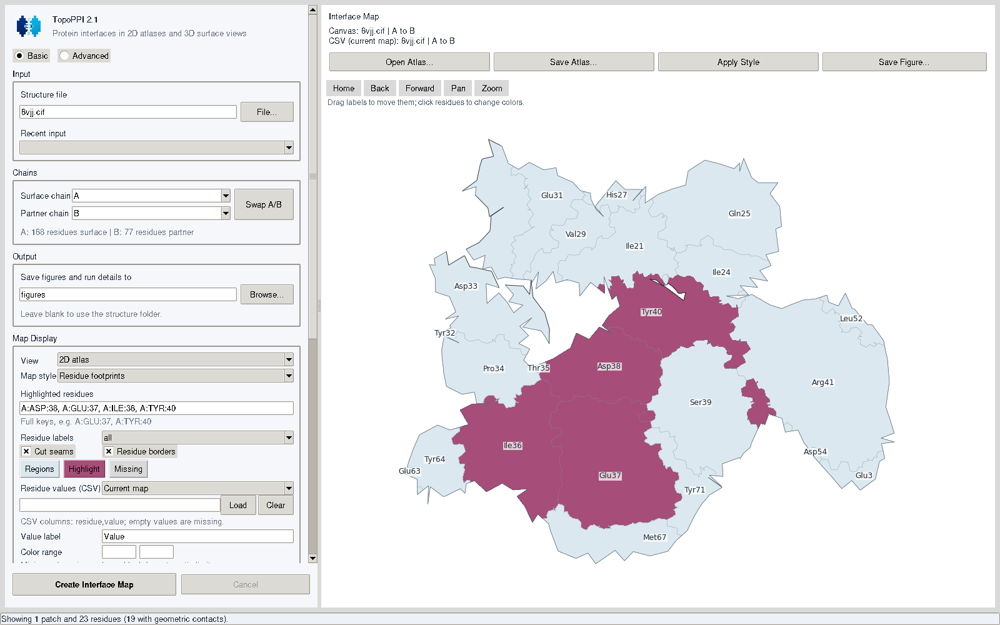
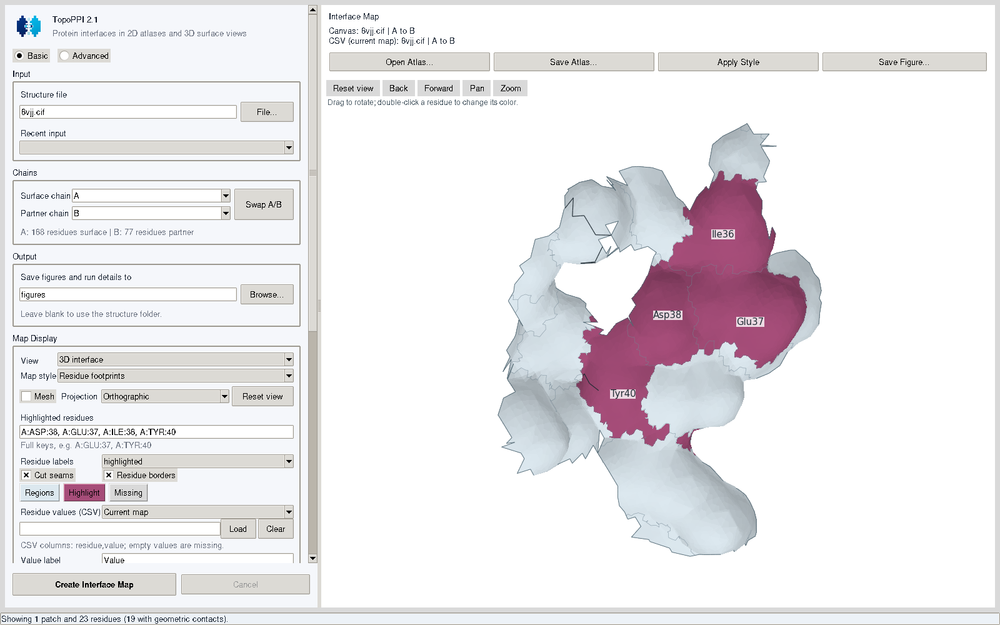
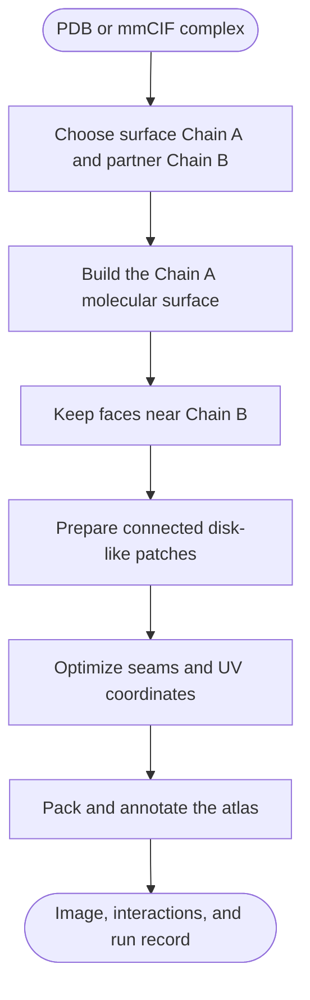

# TopoPPI

<p align="center">
  
</p>

TopoPPI is **a desktop application for exploring protein–protein interfaces in 2D and 3D**. Open a structure, create an interface map, inspect contacting residues, and prepare an editable atlas or a figure. Its shared geometry platform also supports a Python API, command-line workflows and analysis plugins.

Highlight residues, inspect their contacts, and color the interface with your own numerical data. Save an editable atlas to return to your work, or export figures as PNG, TIFF, SVG or PDF. The desktop app, command line and Python API use the same mapping and annotation tools.

**Get started:** [Windows](#windows) · [macOS](#macos) · [Linux](#linux) · [Desktop walkthrough](docs/desktop.md) · [Command line](#command-line) · [Python API](#python-api)

## Core and plugins

Core provides structure selection, author residue identifiers, contacts, surface and topology data, native interface files, visualization, and plugin discovery. Chemistry detects chemical interactions with ProLIF. Affinity and Hotspot provide task-specific features, fitted models, prediction and evaluation. These plugins use shared Core objects and register through the `topoppi.plugins` entry-point group.

For a source installation, use Python 3.10:

```bash
python -m pip install .
topoppi plugins list
python -m topoppi.examples demo --synthetic
```

A published distribution uses `pip install topoppi`. This installs Core and the default Chemistry plugin, including ProLIF, MDAnalysis and RDKit. Chemistry has its own `topoppi_chemistry` package inside the same distribution and loads its backend when requested. Affinity, Hotspot, scikit-learn, PyTorch and model weights are optional. Structure loading, contact detection and native geometry run independently of chemical perception; UV mapping requires OptCuts. The `all` extra adds benchmarking and mesh-export dependencies.

```python
import topoppi

structure = topoppi.load_structure("demo/synthetic_complex.pdb")
interface = topoppi.get_interface(structure, "A", "B")
geometry = topoppi.compute_geometry(interface)
topoppi.save_interface(geometry, "interface.native.npz")

print(structure.chain_ids)
print(geometry.contacts())
print(topoppi.plugins.available("affinity"))
```

Install Affinity with `pip install ./plugins/affinity`, or install both plugins with `pip install ./plugins/affinity ./plugins/hotspot`. Hotspot uses Affinity's shared mutation features. Affinity's `models` extra adds neural/sequence dependencies. Distribution extras `topoppi[affinity]` and `topoppi[hotspot]` also declare these optional packages. Once installed, `topoppi affinity ...` and `topoppi hotspot ...` appear automatically. Standalone plugin commands remain available. Chemistry is available immediately through `topoppi chemistry`; see its [API and backend extension contract](docs/chemistry.md).

In the desktop app, choose **Binding analysis...** for **Binding affinity**, **Mutation effects**, or **Rank hotspots**. Select residues in the hotspot table or interface map and choose **Create variants...** to compose separate or joint substitutions. Tasks share navigation and structure context while retaining their own outputs and model requirements. **Plugins → Manage Plugins...** lists installed tools and installs optional packages; **Install from file...** accepts a local wheel or source archive. Chemistry is included; Affinity and Hotspot remain optional packages.

The `topoppi_representation` package provides native-mesh, UV and direct-table encoding, decoding and physical descriptors. Install `topoppi[representation]` for these interfaces. Use `topoppi representation descriptors` to export descriptors from a structure; see the [representation API and CLI](docs/representation.md) and [optional analysis scripts](scripts/analysis/README.md).

See the [architecture and data contract](docs/architecture.md) and the [minimal third-party plugin](examples/plugin/README.md). The [v2.1 source and documentation](https://github.com/GeraltZeroZhong/TopoPPI/tree/v2.1) remain available for the version used in the TopoPPI interface-mapping paper.

## Example outputs

These four outputs show the same KRAS–RAF1 interface (PDB **6VJJ**, surface chain A, partner chain B). Magenta highlights Ile36, Glu37, Asp38 and Tyr40 in the first three views.

| **2D residue footprints** | **3D interface** |
| --- | --- |
|  |  |
| See the full interface and the area occupied by each residue. | Follow the surface shape while retaining the same residue annotations. |
| **Residue markers** | **Numerical annotations** |
|  |  |
| Locate contacting residues and follow their labels across the map. | Load a CSV file to map your values onto residue regions. |

The numerical example counts contacting partner residues using a 6 Å heavy-atom distance cutoff. See the [Residue footprints guide](https://github.com/GeraltZeroZhong/TopoPPI/blob/HEAD/docs/residue_footprints.md) for CSV formatting and the [3D interface guide](https://github.com/GeraltZeroZhong/TopoPPI/blob/HEAD/docs/3d_interface.md) for camera and display controls.

## Choose a starting point

| Your goal | Start here |
| --- | --- |
| Make a first map on Windows | [Install the Windows app](#windows) and use the **Setup** page |
| Make a first map on a Mac | [Install the macOS app](#macos) and use the **Setup** page |
| Use Linux or automate one structure | [Install with Conda and pip](#linux) and run `topoppi` |
| Call TopoPPI from Python | [Python API](#python-api) |
| Inspect a saved atlas in three dimensions | [3D interface view](#3d-interface-view) |
| Compare methods across a dataset | [Benchmark a dataset](#benchmark-user-supplied-structures) |
| Explore PPI affinity and mutation prediction | [TopoPPI Affinity optional plugin](https://github.com/GeraltZeroZhong/TopoPPI/blob/HEAD/plugins/affinity/README.md) |

**TopoPPI 3.0.0** uses Python 3.10. Desktop installers and source archives are listed on the [3.0.0 release page](https://github.com/GeraltZeroZhong/TopoPPI/releases/tag/v3.0.0).

## Install TopoPPI

The desktop packages install Core. Add Affinity and Hotspot through **Plugins → Manage Plugins...** for the three binding-analysis tasks.

### Windows

Download the 64-bit Windows installer:

```text
TopoPPI-3.0.0-windows-x86_64-setup.exe
```

Get the installer from the [v3.0.0 release](https://github.com/GeraltZeroZhong/TopoPPI/releases/tag/v3.0.0). Open it and keep its setup window open while it creates the dedicated environment. A fresh installation commonly takes 5–15 minutes and uses GitHub, conda-forge, and PyPI. After setup, open **TopoPPI GUI** from the Start Menu. Routine analysis of local structures can run offline.

The current installer is unsigned, so Windows SmartScreen may ask you to confirm the file. Download it from the project release page, select **More info**, then select **Run anyway**. Upgrade, repair, removal, and local build instructions are in the [Windows guide](https://github.com/GeraltZeroZhong/TopoPPI/blob/HEAD/installer/windows/README.md).

### macOS

Download the disk image for your Mac's architecture:

```text
TopoPPI-3.0.0-macos-arm64.dmg       Apple Silicon
TopoPPI-3.0.0-macos-x86_64.dmg      Intel
```

Get the disk image from the [v3.0.0 release](https://github.com/GeraltZeroZhong/TopoPPI/releases/tag/v3.0.0). Open it, drag **TopoPPI** to **Applications**, and open the app. The app uses ad-hoc signing. If macOS blocks it, open **System Settings > Privacy & Security**, choose **Open Anyway** for TopoPPI, and confirm **Open**. Older macOS releases may also offer **Open** through the app's Control-click menu. Keep the preparation window open while the bundled runtime expands. Later launches reuse that runtime.

The app includes Python, scientific dependencies, and native OptCuts, and supports macOS 12 or later. Startup recovery, upgrades, removal, and local build instructions are in the [macOS guide](https://github.com/GeraltZeroZhong/TopoPPI/blob/HEAD/installer/macos/README.md).

### Linux

TopoPPI uses Python 3.10. Create an environment, install version 3.0.0 from PyPI, and launch the desktop app:

```bash
conda create -n topoppi -c conda-forge \
  python=3.10 tk igl=2.6.* numpy scipy biopython scikit-image \
  matplotlib trimesh networkx pillow rtree shapely \
  mdanalysis rdkit psutil tqdm meshio pip
conda activate topoppi
python -m pip install "topoppi[all]==3.0.0"
topoppi-install-optcuts
command -v OptCuts_bin
topoppi-gui
```

`topoppi-install-optcuts` downloads the Linux x86-64 executable matching the installed release. Other Linux architectures use a locally built executable through `TOPOPPI_OPTCUTS_BIN`. To work from a source checkout, install with `python -m pip install ".[all]"` and use `bash tools/OptCuts/install_optcuts.sh` from the repository root.

## Optional affinity analysis (v3.0)

TopoPPI Affinity predicts absolute binding affinity and mutation effects from physicochemical descriptors of the supplied complex. Optional neural models also use sequence representations, native contacts and surface descriptors. Results connect to residue-level 3D surfaces, contact graphs and optional 2D atlases.

With Python 3.10, install the optional plugin from the repository root:

```bash
python -m pip install -e . -e ./plugins/affinity
topoppi-affinity doctor
topoppi-affinity example --output affinity-demo
```

The Affinity plugin uses linear ridge regression for binding affinity (pKd) and kernel ridge regression with a radial basis function (RBF) kernel for mutation-induced changes in binding free energy (ΔΔG). Both run on CPU and use physicochemical descriptors. Hotspot ranks residues by predicted alanine-substitution ΔΔG using a separately fitted RBF kernel ridge model that combines physicochemical and UV-derived spatial descriptors. Each plugin calculates its model inputs from the supplied structure and saves the results. The [workflow guide](https://github.com/GeraltZeroZhong/TopoPPI/blob/HEAD/plugins/affinity/docs/workflow.md#custom-models) also covers custom models. The example command exports the included 1BVK antibody–lysozyme input.

When the plugin is installed, select **Binding analysis... → Binding affinity** or **Mutation effects** in the desktop app. Choose the prediction task, then use the bundled model or select a custom model. Advanced mutation models have separate applicability settings. The legacy `topoppi-install-affinity` command forwards to the installed plugin resource setup; install the plugin package first. It prepares absolute-affinity resources by default; `--task mutation` selects the bundled mutation model; `--task known` and `--task unseen` support separately configured advanced ensembles. `--skip-download` installs software only, and `--models-only` prepares resources using an installed plugin.

The default model weights are bundled with the plugins. Hotspot also requires [native OptCuts](#optcuts-cannot-be-found) for its residue-aware UV representation. Once their dependencies are installed, all three models run offline on CPU. Python examples cover [binding affinity and mutation effects](plugins/affinity/docs/api.md#predict-from-a-structure) and [hotspot ranking](plugins/hotspot/README.md#python-structure-ranking). Neural custom models use the optional `models` dependencies and their declared resources; see the [model guide](plugins/affinity/docs/models.md).

Predictions appear automatically in the main window's **Affinity results** table. To reopen an analysis, choose **Analysis → Open Affinity Result...** or **Open result...** in that card and select `analysis.json`. Select a variant and partner, then **Show interface** to display it on the main canvas; the prediction panel also offers **Show in main window**.

To save an editable affinity atlas, select **Generate 2D atlases** in the prediction panel, display the **2D atlas** in the main window, then choose **Save Atlas**. The file preserves the prediction metadata; **Open Atlas** restores the geometry without the plugin, while the plugin provides the prediction table. Keep the complete analysis directory to display other variants or partners through the plugin.

The [plugin guide](https://github.com/GeraltZeroZhong/TopoPPI/blob/HEAD/plugins/affinity/README.md) covers the first analysis and linked review. The [model guide](plugins/affinity/docs/models.md) describes model inputs and units. The [tool guide](plugins/affinity/tools/README.md) describes reusable fitting and evaluation commands.

## Create an interface map

### Desktop app

Launch `topoppi-gui`, or open the installed application on Windows or macOS.

<details>
<summary>Desktop screenshots: 2D atlas and 3D interface</summary>

**2D atlas:** inspect residue regions and adjust labels, highlights and colors.



**3D interface:** rotate the surface and save the view for later editing or export.



</details>

1. On **Setup**, choose a `.pdb`, `.cif`, or `.mmcif` structure.
2. Review the detected protein chains and residue counts.
3. Set **Surface chain** to the protein whose surface you want to map.
4. Set **Partner chain** to the contacting protein. **Swap** maps the opposite surface.
5. Choose the output folder. Display preferences are available on **Appearance**.
6. Select **Create Interface Map** at the bottom of the sidebar.

For a first run in TopoPPI 3.0, select **Try 1BVK Example...** in the workspace or **File** menu and choose an output folder. TopoPPI copies the bundled antibody–lysozyme structure there, selects surface chain B and partner chain C, and prepares the form. Select **Create Interface Map** to generate the map and interaction annotations. The example is included with the core package and works offline once OptCuts is available. An unchanged example can be reused; edited input files remain intact.

Once the result appears, choose **2D atlas** or **3D interface** beside the canvas. Open **Appearance** for **Map Display**, colors and labels; **Map style** switches between residue markers and filled residue footprints. **Save Atlas** keeps the result editable; **Save Figure** exports the current view.

TopoPPI generates ProLIF annotations when no interaction JSON is supplied. The completed run writes the image, its `.topoppi.json` run record, and the generated `.prolif.json` file to the chosen output folder. **Advanced** contains surface, topology, UV, OptCuts and export settings. **Binding analysis...** opens the affinity, mutation-effect and hotspot tasks.

The **Help** menu shows the installed version and opens the user guide or issue tracker. During a run, the status area reports `Load`, `Surface`, `Patch`, `OptCuts`, and `Render` progress. Select **Show activity** below the workspace to view detailed messages. **Copy diagnostics** and **Save log...** include the run settings and messages for troubleshooting.

The map panel identifies the structure and chain pair it displays. Preparing another input leaves the current atlas available for editing and saving. Once computation finishes, display settings can be adjusted with **Apply Style** using the calculated atlas.

### Command line

The shortest command is:

```bash
topoppi path/to/complex.pdb \
  --chain-a A \
  --chain-b B \
  --output interface_map.png
```

This creates:

```text
interface_map.png
interface_map.topoppi.json
complex.A-B.prolif.json
```

The generated ProLIF file is placed beside the output image. Supply an existing file with `--prolif interactions.json` when interaction evidence has already been prepared.

For an independently generated toy input, use:

```bash
python -m topoppi.examples synthetic-example --synthetic
topoppi synthetic-example/synthetic_complex.pdb -A A -B B \
  --interaction-source geometric --min-points 1 --map-style footprints \
  --export-atlas synthetic-example/interface.npz -o synthetic-example/interface.png
```

The two short peptide chains are artificial. This checks the mapping and rendering path with a small input. The [fixture guide](tests/fixtures/README.md) records its construction.

TopoPPI 3.0 includes the real 1BVK antibody–lysozyme structure. Export it to a writable folder and map antibody chain B against lysozyme chain C:

```bash
python -m topoppi.examples topoppi-example
topoppi topoppi-example/1bvk.pdb \
  -A B -B C --map-style footprints \
  --export-atlas topoppi-example/1bvk_B-C.atlas.npz \
  -o topoppi-example/1bvk_B-C.png
```

The command generates its ProLIF annotations and saves all outputs in `topoppi-example`. Use `--optcuts-bin /path/to/OptCuts_bin` when the solver is outside the usual search paths. Whole-complex affinity analysis uses antibody chains A,B together against chain C; see the [affinity example](https://github.com/GeraltZeroZhong/TopoPPI/blob/HEAD/plugins/affinity/examples/README.md).

Useful defaults and options:

| Option | Default | Purpose |
| --- | ---: | --- |
| `-A`, `--chain-a` | `A` | Surface protein |
| `-B`, `--chain-b` | `B` | Partner used to locate the interface |
| `--cutoff` | `4.0 Å` | Maximum surface-face distance to Chain B |
| `--min-points` | `1` | Minimum interaction residues per visible 2D marker patch |
| `--residue-scope` | `interaction` | Annotation scope; footprints and 3D views default to `patch` |
| `--map-style` | `markers` | `footprints` draws filled residue regions, boundaries, and seams |
| `--view` | `atlas` | `surface` displays the interface in 3D |
| `--projection` | `orthographic` | `perspective` adds camera perspective in 3D |
| `--elevation`, `--azimuth`, `--zoom` | `73`, `-90`, `1` | 3D camera angles in degrees and positive zoom factor |
| `--no-mesh`, `--show-mesh` | shown | Hide or show the 3D triangular mesh |
| `--interaction-source` | `prolif` | Installed chemistry backend; `geometric` uses heavy-atom contact partners for optimization weights |
| `--res` | `1.0 Å` | Surface grid spacing |
| `--max-voxels` | `40,000,000` | Dense-grid allocation budget |
| `--parameterization` | `auto` | Initial UV parameterization |
| `--residue-fragmentation-weight` | `20` | Residue-aware seam objective strength |
| `--optcuts-timeout` | `600 s` | OptCuts budget for each patch |
| `--interactions`, `--prolif` | empty | Existing interaction JSON; `--prolif` remains a compatible alias |
| `-o`, `--output` | `interface_map.png` | PNG, TIFF, SVG, or PDF image path |
| `--export-atlas` | empty | Save a self-contained NPZ atlas for later rendering |

Run `topoppi --help` for mapping options and `topoppi render --help` for saved-atlas editing and `topoppi --version` to check the active installation. Add `--show` when you want the Matplotlib window to remain open after saving.

### Residue footprints

Choose **Residue footprints** under **Appearance → Map Display** in the desktop app, or add `--map-style footprints` to a CLI run. This style draws complete residue regions, including disconnected pieces, in either the 2D atlas or the 3D interface view. It supports selected-residue highlighting, external numerical annotations, boundary and seam controls, and editable SVG/PDF exports.

```bash
topoppi complex.cif -A A -B B --map-style footprints \
  --highlight A:GLU:37 A:TYR:40 \
  --export-atlas interface.atlas.npz -o interface.svg

topoppi render interface.atlas.npz --annotation-file effects.csv \
  --annotation-label 'Effect (kcal/mol)' -o interface_effects.pdf
```

`effects.csv` contains `residue,value` columns, with source author residue identifiers and numeric values or `NA`. Saved atlases retain geometry, interactions, numerical annotations and plotting style. **Save Atlas / Open Atlas** and `topoppi render` support further editing without the original input files or a new optimization. The GUI supports region recoloring and label dragging. Numerical annotations set region colors and supply a shared value scale; **Clear** restores the manual color layer.

CSV files use UTF-8, including exports with a byte-order mark. Colorbar arrowheads show when values extend beyond a selected scale. The GUI distinguishes annotations for the current map from those prepared for the next run.

See the [Residue footprints guide](https://github.com/GeraltZeroZhong/TopoPPI/blob/HEAD/docs/residue_footprints.md) for CSV examples, complete options, the Python API and reproducible rendering.

### 3D interface view

Choose **3D interface** beside the canvas, then open **Appearance → Map Display** and choose **Residue markers** or **Residue footprints** under **Map style**. Drag to rotate; use the navigation toolbar to pan or zoom. **Mesh**, **Projection** and **Reset view** control the surface display and camera. Double-click a visible residue to edit its manual color. Numerical annotations share the value scale used by the atlas.

To render a saved atlas in 3D:

```bash
topoppi render interface.atlas.npz \
  --view surface --map-style footprints \
  --highlight A:GLU:37 A:TYR:40 --labels highlighted \
  --elevation 73 --azimuth -90 --zoom 1 \
  --export-atlas surface.atlas.npz -o interface_3d.png

topoppi render surface.atlas.npz --no-mesh -o interface_3d.pdf
topoppi render surface.atlas.npz --view atlas -o interface_2d.svg
```

The 3D view uses the stored surface vertices and preserves the relative positions of all retained patches. Switching views reuses the completed atlas. **Save Atlas** preserves the camera for subsequent editing and export. Rendering runs entirely in TopoPPI with Matplotlib; PyMOL is optional for separate molecular illustrations.

See the [3D interface guide](https://github.com/GeraltZeroZhong/TopoPPI/blob/HEAD/docs/3d_interface.md) for camera settings, annotations and the Python API.

### Python API

The Core object API above separates loading, interface selection and native geometry. Use the mapping API to generate optimized UV atlases:

```python
from topoppi.config import TopoPPIRunConfig
from topoppi.pipeline import run_interface_mapping

result = run_interface_mapping(
    TopoPPIRunConfig(
        pdb_file="complex.pdb",
        chain_a="A",
        chain_b="B",
        output_file="results/complex_A-B.png",
    )
)

print(result.output_file)
print(result.manifest_file)
print(result.elapsed_sec)
```

Configuration dataclasses live in [`src/topoppi/config.py`](https://github.com/GeraltZeroZhong/TopoPPI/blob/HEAD/src/topoppi/config.py). The same settings feed the CLI, desktop app, Python pipeline, and benchmark runner.

UV mapping requires a native OptCuts executable. On Linux x86-64, the [source setup](#install-from-a-linux-x86-64-source-checkout) installs the supplied binary; `topoppi-install-optcuts` serves published pip installations. The [Windows installer](https://github.com/GeraltZeroZhong/TopoPPI/blob/HEAD/installer/windows/README.md) configures the bundled Windows executable, while standalone Windows environments can run `topoppi-install-optcuts --platform windows-x86_64`. On macOS, follow the [native build instructions](https://github.com/GeraltZeroZhong/TopoPPI/blob/HEAD/installer/macos/README.md#build-locally). Set `TOPOPPI_OPTCUTS_BIN` to the resulting executable when it is outside the active environment's command path.

## Understand the result



### Read the map

- Each island is a connected piece of the selected Chain A interface surface.
- The mesh shows the flattened surface geometry. Island boundaries include natural patch boundaries and optimization seams.
- Residue regions and markers belong to Chain A. Their labels can also show paired Chain B residues.
- Marker colors encode the selected interaction classes. Footprint mode uses a neutral region color, selected-residue highlights, or a numerical value scale.
- A residue split by a seam can appear on more than one island. TopoPPI places a marker on every connected UV footprint piece.
- Two-dimensional spacing describes the optimized atlas. Use the source structure for physical three-dimensional distance measurements.

The adjacent `.topoppi.json` file records the exact input hash, chains, settings, software environment, OptCuts executable, timings, surface diagnostics, topology measurements, display scope, and interaction counts. Keep it with figures used in analysis or publication.

### Mapping details

- TopoPPI reads the first structural model and uses recognized amino-acid heavy atoms from Chain A.
- The molecular surface is a Gaussian-density isosurface extracted with marching cubes.
- Interface faces are selected from their distance to Chain B heavy atoms. GUI, CLI, and Python single-run defaults all use `4.0 Å`.
- UV coordinates are stored per face corner, so both sides of a seam keep their own coordinates.
- Multiple retained patches are packed with deterministic transforms and an explicit chart gap.

TopoPPI extends OptCuts with residue-footprint fragmentation energy. For an original footprint component with surface area `M` split into pieces with areas `m_k`, the contribution is:

```text
1 - sum((m_k / M)^2)
```

Each residue receives the weight `1 + contact degree`, where contact degree is the number of distinct Chain B partners in the ProLIF records by default. With `--interaction-source geometric`, it counts partners within the specified heavy-atom distance. The standard TopoPPI weight is `20`. A weight of `0` selects the matched geometry-only ablation used in benchmark comparisons. The [benchmark schema](https://github.com/GeraltZeroZhong/TopoPPI/blob/HEAD/docs/benchmark_schema.md#residue-footprint-fragmentation) gives the formal definition and exported evidence.

## Interaction annotations

The included Chemistry plugin generates chemical annotations through ProLIF. With the mapping default `--interaction-source prolif`, TopoPPI uses interaction evidence in this order:

1. Read the ProLIF JSON supplied through the CLI, Python configuration, or Advanced desktop page.
2. Generate a chain-pair ProLIF JSON with MDAnalysis, ProLIF, and RDKit.
3. Use geometric interaction assignment when the user enables that diagnostic fallback.

Choose `--interaction-source geometric` to use distance-based partners directly and skip ProLIF generation. The contact distance is controlled by `--geometric-fallback-distance` (default `6 Å`); `--cutoff` separately defines the mapped surface domain (default `4 Å`). This selection changes optimization weights. Footprint colors and external annotations are applied after optimization.

During generation, TopoPPI prepares isolated RDKit copies of the selected chains, adds explicit hydrogens, and runs the ProLIF fingerprint. Source coordinates stay unchanged. Generated metadata binds the records to the structure SHA-256, chain direction, interaction schema, and TopoPPI version.

`topoppi chemistry backends` lists installed detection backends. ProLIF is the supplied backend. Additional packages can register through the Chemistry plugin's backend entry points for discovery by the CLI and desktop selector. See the [Chemistry guide](docs/chemistry.md) for direct detection from shared objects and the extension contract. Formal benchmarks require the ProLIF records specified by their execution profile.

The display normalizes ProLIF subclasses into `HydrogenBond`, `Ionic`, `PiStacking`, `PiCation`, `Hydrophobic`, `HalogenBond`, `MetalCoordination`, `VdWContact`, and `Other`. PDB insertion codes are retained when they resolve uniquely.

Use `--residue-scope patch` or **Full patch context** to label the surrounding flattened surface. The standard `interaction` scope labels residues supported by the resolved interaction records.

## Benchmark user-supplied structures

The benchmark CLI compares configured parameterization methods on structures and chain pairs supplied by the user. Reports record failures, geometry, runtime, interaction retention and input provenance. Install the `benchmark` extra to use resource monitoring.

```bash
topoppi-benchmark preflight docs/benchmark_quickstart.example.json
topoppi-benchmark run docs/benchmark_quickstart.example.json
```

The quickstart uses synthetic structures to exercise the benchmark workflow. Native OptCuts is required. Configuration paths are relative to the JSON file; choose an output directory before running. The [configuration template](docs/benchmark_config.example.json) documents formal input provenance fields, and the [evidence schema](docs/benchmark_schema.md) defines the output tables, units, comparison domains and sensitivity plans. Use experimental data to assess scientific performance.

## Optional hotspot ranking

[TopoPPI Hotspot](plugins/hotspot/README.md) ranks interface residues by predicted alanine-substitution ΔΔG at 298.15 K. Its bundled CPU model uses shared Affinity features and a residue-aware UV representation prepared with OptCuts. Install the plugins from the repository root:

```bash
python -m pip install -e ./plugins/affinity -e ./plugins/hotspot
```

Its [README](plugins/hotspot/README.md) describes OptCuts setup, the ranking command, model inputs, saved outputs and custom models. Core and the two plugins are separate distributions; installing Hotspot also installs Affinity and the representation dependencies.

## Install from a Linux x86-64 source checkout

This procedure uses the Linux x86-64 OptCuts executable tracked in the source tree. Use the [Windows native build guide](https://github.com/GeraltZeroZhong/TopoPPI/blob/HEAD/installer/windows/README.md#build-locally) or [macOS native build guide](https://github.com/GeraltZeroZhong/TopoPPI/blob/HEAD/installer/macos/README.md#build-locally) when developing on those platforms.

```bash
git clone https://github.com/GeraltZeroZhong/TopoPPI.git
cd TopoPPI
conda env create -f environment.yml
conda activate topoppi-dev
python -m pip install -e ".[dev,benchmark,meshio,representation,analysis]"
bash tools/OptCuts/install_optcuts.sh
command -v OptCuts_bin
```

The checkout includes a Linux x86-64 OptCuts executable for development. Rebuild the pinned residue-aware source with:

```bash
bash tools/OptCuts/build_residue_aware_optcuts.sh \
  tools/OptCuts/OptCuts_bin
```

The [OptCuts notice](https://github.com/GeraltZeroZhong/TopoPPI/blob/HEAD/tools/OptCuts/NOTICE.md) records the upstream commit, patch behavior, executable SHA-256, platform distribution, and license. The [residue-aware integration guide](https://github.com/GeraltZeroZhong/TopoPPI/blob/HEAD/tools/OptCuts/residue_aware/README.md) documents the sidecar and C++ state engine.

An explicit `--optcuts-bin` path takes precedence. With the default command name, TopoPPI uses `TOPOPPI_OPTCUTS_BIN`, then searches the active `PATH` and standard installation locations. Point to a local build with:

```bash
export TOPOPPI_OPTCUTS_BIN=/absolute/path/to/OptCuts_bin
```

## Troubleshooting

### OptCuts cannot be found

Activate the intended environment. In a Linux x86-64 source checkout, install its executable:

```bash
bash tools/OptCuts/install_optcuts.sh
command -v OptCuts_bin
```

For a published pip installation, run `topoppi-install-optcuts` to download the matching release executable. Use `topoppi-install-optcuts --force` to replace the executable at the selected destination. Windows and macOS users should follow the native OptCuts guidance in the [Python API section](#python-api).

### A chain is missing

TopoPPI reports the available protein chains from the first model. Check capitalization, choose two distinct chains, and use **Swap A/B** when the intended surface is currently the partner. The desktop chain preview also shows residue counts.

### No interface patch is found

Confirm that the file contains the intended biological assembly and chain pair. Compare the partner distance with the `4.0 Å` interface cutoff and increase `--cutoff` gradually for a wider coordinate gap.

### ProLIF generation fails

Check that both chains contain complete protein residues and that the interaction stack imports:

```bash
python -c "import MDAnalysis, prolif, rdkit; print('interaction stack ready')"
```

You can supply a prepared record with `--prolif FILE`. For a distance-based diagnostic, enable `--geometric-interaction-fallback`.

### Surface generation reaches the voxel budget

Single runs can coarsen the grid up to `--max-adaptive-resolution`. Increase `--res`, raise `--max-adaptive-resolution`, or increase `--max-voxels` when memory permits. Formal fixed-resolution studies should record the chosen budget in their configuration and preflight report.

### The desktop app does not start

- Windows startup errors are written to `%LOCALAPPDATA%\TopoPPI\gui-startup.log`; follow the [repair steps](https://github.com/GeraltZeroZhong/TopoPPI/blob/HEAD/installer/windows/README.md#repair-an-installation).
- macOS startup errors are written to `~/Library/Logs/TopoPPI/launcher.log`; follow the [runtime rebuild steps](https://github.com/GeraltZeroZhong/TopoPPI/blob/HEAD/installer/macos/README.md#repair-startup).
- Linux users can start `topoppi-gui` from a terminal to see the active environment and import error.

## Develop, cite, and license

Run the project checks with:

```bash
conda activate topoppi-dev
python -m pytest
python -m ruff check src tests installer
```

For headless Linux testing, use `xvfb-run -a python -m pytest` so the Tk interaction tests run as they do in CI.

The complete contribution workflow is in [CONTRIBUTING.md](https://github.com/GeraltZeroZhong/TopoPPI/blob/HEAD/CONTRIBUTING.md). Cite TopoPPI with [CITATION.cff](https://github.com/GeraltZeroZhong/TopoPPI/blob/HEAD/CITATION.cff).

TopoPPI is distributed under the [MIT License](https://github.com/GeraltZeroZhong/TopoPPI/blob/HEAD/LICENSE). OptCuts redistribution details are in the [build and license notice](https://github.com/GeraltZeroZhong/TopoPPI/blob/HEAD/tools/OptCuts/NOTICE.md) and its upstream [`LICENSE.txt`](https://github.com/GeraltZeroZhong/TopoPPI/blob/HEAD/tools/OptCuts/LICENSE.txt).
