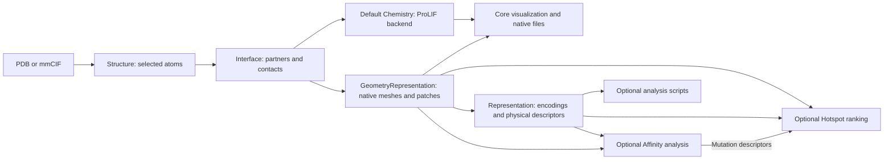

# Platform architecture

TopoPPI 3.0 provides a desktop visualization workspace backed by a modular platform
for protein–protein interface geometry and structure-aware analysis. Core handles
shared structures, geometry and the main canvas. Chemistry
is a default plugin; Affinity and Hotspot are optional plugins. They implement
scientific tasks through a shared registration interface. The sibling
`topoppi_representation` package provides encodings and physical descriptors.
The [v2.1 source and documentation](https://github.com/GeraltZeroZhong/TopoPPI/tree/v2.1)
document the release used in the TopoPPI paper.

## Data flow and boundaries



Plugins depend on Core; the representation package also consumes Core objects.
Hotspot uses Affinity's mutation-feature API and the representation package's
surface descriptors and UV codec.
Core discovers providers through package metadata and leaves task implementations and optional
analysis dependencies unloaded during ordinary package import.

```text
src/topoppi/
├── __init__.py          Stable lazy Python exports
├── structure.py         Loaded structures and selected author chains
├── interface.py         Contact interfaces and legacy prepared geometry
├── geometry.py          Native surface/topology computation
├── contacts.py, residues.py  Shared geometric contact and identity primitives
├── interface_io.py      Self-contained native NPZ records
├── plugins.py           Discovery, metadata, registry and capability execution
├── execution.py         Per-call configuration, logging and cancellation
├── cli.py               Core commands and dynamic plugin dispatch
├── config.py            Core numerical and rendering configuration
├── io/, mesh/, atlas/
├── visualization/, gui_app/, pipeline.py
└── interactions/        Generic records, sidecar I/O and plugin dispatch
src/topoppi_chemistry/    Default Chemistry provider, detection and label rules
└── backends/prolif.py    ProLIF perception from selected Core atoms
src/topoppi_representation/  Encoding carriers, codecs and physical descriptors
├── schema.py, adapters.py   Representation objects and shared-geometry adapters
├── codecs/                 Native, UV and direct-table codecs
├── descriptors/            Atomic and surface physical quantities
├── cli.py                  Structure-to-descriptor table export
└── analysis/               Optional physical and finite-graph readers
scripts/analysis/           Parameterized analysis and reproducibility commands
plugins/
├── affinity/            Descriptors, mutation features, models and prediction UI
└── hotspot/             Residue features, frozen-model scoring and ranking
examples/plugin/         Independent plugin depending on the topoppi distribution
```

Core provides atlas rendering, native geometry, UV parameterization and geometry
benchmark utilities. Model training, prediction, task-specific evaluation,
amino-acid encodings, feature normalization
and model resources belong to plugins. Shared representation codecs and physical
descriptor definitions belong to `topoppi_representation`. It preserves each
feature scheme's declared chemical classes, neighborhoods and units. Chemistry
provides interaction detection and geometric chemical-label rules; Core owns
distance-based contacts and annotation rendering.

## Scientific data contract

```python
import topoppi

structure = topoppi.load_structure("complex.cif")
interface = topoppi.get_interface(structure, "A,B", "C", contact_distance=6.0)
geometry = topoppi.compute_geometry(interface)
topoppi.save_interface(geometry, "interface.native.npz")
restored = topoppi.load_interface("interface.native.npz")
```

`Structure` retains the first model, selected protein heavy atoms, author chain,
residue and insertion identities, and source provenance. Core uses the loader's
amino-acid recognition and alternate-conformer selection. `Interface`
retains complete disjoint partner groups and geometric contacts before surface
generation. It preserves the caller's A/B orientation. Plugins may canonically
order features according to their declared schemes.

`GeometryRepresentation` is an alias for `PreparedInterface`. Its partners expose
chains, atoms, coordinates, full native meshes, retained patches and preparation
reports. `partner(group)`, `chain_data`,
`contacts` and independent layout copies remain available. Existing
`topoppi.interface.prepare_interface(path, ...)` callers and native NPZ version-1
records remain supported. A restored geometry can be used after the original
structure has been removed.

Coordinates and distances use angstroms; areas use square angstroms. The default
heavy-atom contact distance is 6 Å. The retained surface-face cutoff is a separate
4 Å topology parameter. Model plugins require supplied geometry to match their
declared surface and topology settings.

Arrays and atom objects are shared. Copy them before changing geometry. Plugin
transforms derive features and task graphs from the supplied objects, preserving
the shared native surfaces and independence from the original structure file.

## Plugin contract

A provider exposes `metadata` and `register(registry)`. Metadata declares a name,
version, description and capability names. Registration supplies callable objects
or lazy `module:function` references:

```python
from topoppi.plugins import PluginMetadata

class ExamplePlugin:
    metadata = PluginMetadata("example", "0.1", "Example analysis.", ("example.analyze",))

    def register(self, registry):
        registry.register_capability("example.analyze", "example_plugin:analyze")
        registry.register_command("example", "example_plugin:main")

plugin = ExamplePlugin()
```

The package declares its provider in `pyproject.toml`:

```toml
[project.entry-points."topoppi.plugins"]
example = "example_plugin:plugin"
```

Capability handlers accept `context=`; command handlers accept `argv` and return
an exit status. Registration modules should remain small and import task
implementations only when executing them. `plugins.list()` returns metadata
without importing providers; `plugins.info(name)` loads that provider's
registration metadata. `plugins.available(name)` reports installed providers.
Model-resource checks belong to each provider's task interface. Failed imports
and missing capabilities produce TopoPPI-level errors with installation guidance.
Before a provider is loaded, listing uses its distribution's version and
description and leaves capabilities empty; use `info(name)` to read its declared
capabilities.

```python
import topoppi
from topoppi_hotspot.inference import model_requirements

print(topoppi.plugins.list())
print(topoppi.plugins.info("hotspot"))
protocol = model_requirements()["feature_protocol"]
geometry = topoppi.compute_geometry(
    interface,
    surface=topoppi.SurfaceConfig(**protocol["surface"]),
    topology=topoppi.TopologyConfig(**protocol["topology"]),
)
ranking, metadata = topoppi.run(
    "hotspot.rank", geometry, partner="A,B",
    output_dir="rankings",
)
```

A registry can also register a local provider
directly with `registry = topoppi.PluginRegistry()` followed by
`registry.register_plugin(plugin)` and `registry.run("example.analyze", geometry)`.
Call `topoppi.plugins.refresh()` after installing a distribution in a running
Python session. The [working example](../examples/plugin/README.md) demonstrates package
installation, automatic discovery, Python execution and CLI dispatch.

## Configuration and execution

`ExecutionContext` keeps Core settings and per-plugin configuration separate.
Core accepts configuration for optional providers and loads implementations when
requested. Contexts provide a logger, cancellation checks and optional progress reporting;
plugins define their supported fields. Core configuration uses validated
scientific dataclasses. Affinity and Hotspot include CPU models. Omit
model arguments to select those defaults, or supply a compatible custom model.

```python
from pathlib import Path
import topoppi

context = topoppi.ExecutionContext(
    plugin_config={"hotspot": {"partner": "A,B"}},
    output_dir=Path("rankings"),
    progress=lambda event: print(event["stage"]),
)
ranking, metadata = topoppi.run("hotspot.rank", geometry, context=context)
```

Capabilities receive this context as a keyword argument. Registry execution
emits `started` and one terminal stage (`completed`, `failed`, or `cancelled`);
plugins may emit finer progress events. Set `context.cancel_event` to request
cooperative cancellation. GUI factories and existing command handlers retain
their `factory(host)` and `main(argv)` signatures.

```bash
topoppi plugins list --json
topoppi plugins info chemistry --json
topoppi chemistry backends
topoppi plugins info hotspot --json
topoppi interface complex.pdb -A A -B B -o contacts.json
topoppi geometry complex.pdb -A A -B B -o geometry.npz
topoppi representation descriptors --structure complex.pdb -A A -B B -o descriptors
topoppi hotspot rank-complex --help
```

Installed providers add their task commands. Core help and discovery do not load
prediction implementations or PyTorch. The original mapping CLI
`topoppi complex.pdb -A A -B B ...`, `render` command and standalone plugin CLIs
remain supported.

## Representation and analysis interfaces

`topoppi_representation` ships in the Core distribution as a separate code
namespace. `from_geometry` adapts existing Core geometry and explicit UV layouts
into a representation source. Native and UV decoders return spatial `Surface`
objects; the direct codec returns the named physical table that it encodes. Codecs retain
residue identities, area units and complete encoded-byte accounting.

`physical_descriptors` computes 477 physicochemical interface descriptors from
selected partner atoms. `topoppi representation descriptors` exports these
fields and optional residue and contact tables. Surface queries use the supplied surface representation.
The [representation guide](representation.md) defines the input fields, output
objects and optional dependencies. Core atom/residue identities remain Core
objects; representation-specific data structures live in the sibling package.

The [analysis scripts](../scripts/analysis/README.md) provide encoding/resource
comparisons, physical recovery and finite graph readouts. Inputs, partitions,
parameters and output directories are explicit. Scientific operations are
importable, while the scripts provide reproducible command-line entry points.
PyTorch is loaded when the finite graph reader is used; codecs and linear
physical readers can run independently.

## Official prediction models

Affinity predicts binding affinity (pKd) with linear ridge regression and
mutation-induced changes in binding free energy (ΔΔG) with kernel ridge regression
using a radial basis function (RBF) kernel. Both models use physicochemical
descriptors. Hotspot uses a separately fitted RBF kernel ridge regressor to predict
alanine-substitution ΔΔG. Residues are ranked in descending order of predicted
ΔΔG, with positive values indicating weaker binding. The model combines 430
physicochemical mutation descriptors, the temperature covariate T/(298.15 K)
(set to 1 at 298.15 K), and 121 spatial descriptors from a decoded residue-aware
UV representation. Its encoding budget is one quarter of the serialized,
uncompressed native source size, including both partner surfaces and the full
residue table.
Hotspot shares the mutation-descriptor calculation with Affinity and uses
its own fitted weights.

The models include portable preprocessing arrays, ordered feature schemas and
model cards describing their training populations and applicability. All three
run locally on CPU. Hotspot's surface encoding also requires a native OptCuts
executable, available through the [platform installation instructions](../README.md#optcuts-cannot-be-found).

Each result records its model identity, input choices, units or score meaning,
and saved interface geometry. The models can be replaced through the existing
custom-model interfaces. Legacy neural/sequence models retain their optional
software and upstream-resource requirements.

## Dependencies and compatibility

`pip install topoppi` installs Core and the default Chemistry plugin, including
MDAnalysis, ProLIF and RDKit (and transitive dependencies such as pandas).
`topoppi_chemistry` is a code namespace installed and removed with the Core
distribution. The existing `chemistry` extra is retained as an empty compatibility alias. Affinity and Hotspot remain
separate, optional distributions; the base requirements contain neither their
packages nor scikit-learn or PyTorch. The `representation` extra installs codec
and physical-descriptor requirements. Hotspot depends on Affinity and this extra
for its shared features and surface encoding. Optional analysis extras provide linear
or neural readers; see the representation guide for installation commands.

Structure selection, geometric contacts and native geometry load independently
of chemical detection libraries and OptCuts. Mapping requests chemical labels
through the plugin registry. Chemistry discovers backends through `topoppi.chemistry.backends`; only ProLIF is supplied
with TopoPPI. The [Chemistry contract](chemistry.md) documents backend registration
and provider-independent records. ProLIF file compatibility and benchmark
provenance requirements are preserved.

Existing mapping, feature-extraction, standalone inference and saved-file APIs
remain supported. New task calls should use shared geometry. Deprecated
Affinity installer and GUI launch adapters forward explicit legacy requests;
the plugin owns their implementation. GUI extensions mount through a generic
registry callback. Without the plugin, saved geometry remains viewable and
unknown task metadata is preserved.

The desktop **Plugins** manager combines entry-point discovery with a small
display catalog of included and optional tools. The catalog supplies descriptions,
guides and installation suggestions; runtime registration stays independent of
that list, so third-party providers appear automatically. Package installation
uses the running Python environment and retains the installed Core version.
Plugin controllers own their task windows and saved results. The host provides
the selected structure, current native geometry when available, shared rendering
and document lifecycle hooks. A plugin checks the geometry's actual partner and
protocol coverage before reuse.

The desktop host also provides shared **Binding analysis** navigation. Controllers
register scientific tasks with `register_binding_task` and receive explicit
structure and partner context through `open_binding_task`. Affinity registers
absolute affinity and mutation effects; Hotspot registers residue ranking.
This navigation does not import optional model implementations. Selected author
residue identities enter `create_variants_from_residues`, where the user chooses
targets and separate/joint grouping. The resulting explicit variants are appended
to the variant list after the structure and residue identifiers are checked.
Scientific task, mutation applicability and model source remain separate Affinity controls.

## API scope

The documented objects and top-level exports form the supported plugin API.
Low-level mesh and footprint helpers are implementation details and may change.
Visualization dependencies are part of Core. TopoPPI supports Python 3.10,
consistent with its native and Python dependency requirements.
